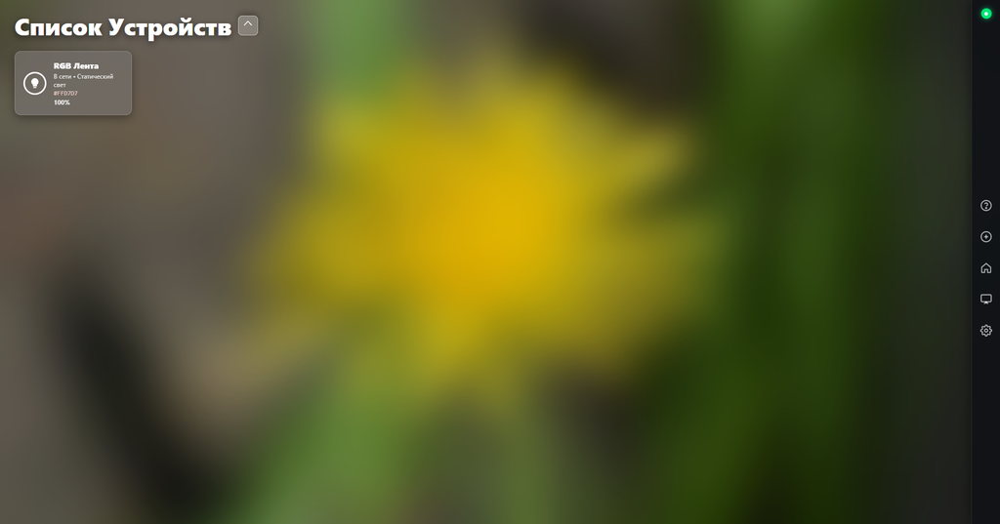
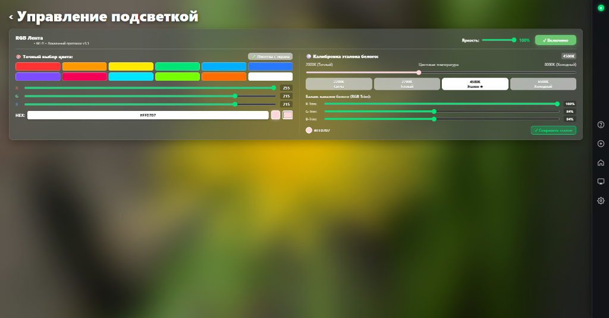
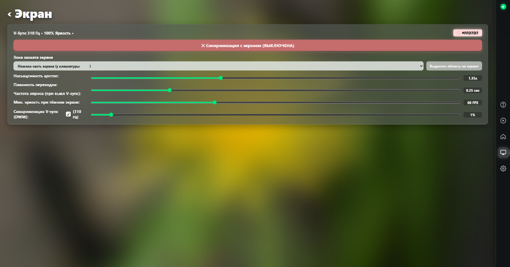
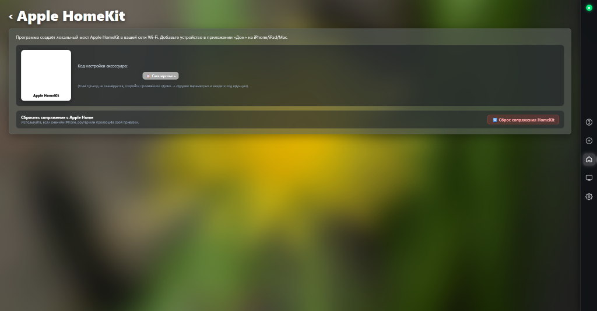
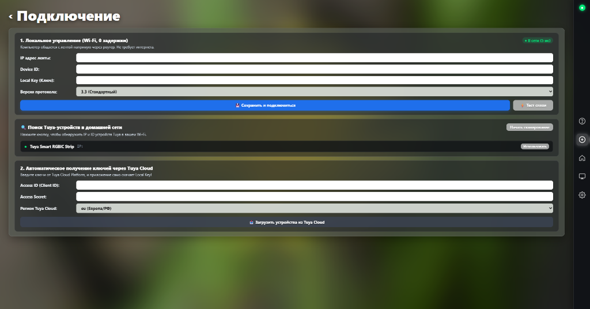

# 🌼 flowerRGB — Smart Life / Tuya RGB Strip Controller (Desktop Edition)

<p align="center">
  
</p>

<p align="center">
  <strong>flowerRGB</strong> — современное высокопроизводительное настольное приложение для Windows для локального управления умными светодиодными лентами <strong>Tuya / Smart Life</strong> с аппаратной поддержкой <strong>Apple HomeKit</strong>, <strong>Razer Chroma RGB</strong> и ультраплавного адаптивного захвата экрана <strong>Ambilight (до 310 Гц)</strong>.
</p>

<p align="center">
  
</p>

---

## ✨ Основные возможности

- 🖥 **Современный Glassmorphism-интерфейс**: рендеринг на базе нативного движка Windows WebView2 с аппаратным ускорением и эффектом матового стекла.
- ⚡ **Нулевая задержка (Локальный протокол Tuya LAN)**: общение с контроллером ленты напрямую через домашний роутер по локальной сети Wi-Fi (v3.1, v3.3, v3.4, v3.5) без задержек облака.
- 🍏 **Встроенный мост Apple HomeKit**: локальный HAP-сервер прямо в приложении. Мгновенное добавление в приложение «Дом» на iPhone, iPad, Apple Watch и Mac по QR-коду и управление голосом через **Siri**.
- 🎮 **Ambilight / V-Sync Screen Sync (до 310 Гц)**: захват цветов монитора через DirectX Desktop Duplication API (DWM) с мгновенной адаптацией под динамичные игры, видео и фильмы.
- 🐍 **Синхронизация с Razer Chroma RGB**: автоматическая интеграция с локальным Chroma SDK для полной гармонии ленты с подсветкой клавиатуры, мыши и коврика.
- 🌅 **Астрономическое расписание (Солнце)**: автоматическое включение на закате и выключение на рассвете по астрономическим координатам вашего города.
- 💤 **Мониторинг бездействия (Idle Watcher)**: автоматическое отключение подсветки при отсутствии активности пользователя за ПК и моментальное включение при касании мыши/клавиатуры.
- 🔔 **Системный трей Windows**: сворачивание в область уведомлений возле часов, быстрое переключение пресетов и выбор цвета пипеткой с экрана.
- 🔒 **Автоматическое получение ключей**: встроенный мастер поиска устройств в сети и загрузка Local Key через Tuya Cloud API.

<p align="center">
  
</p>

---

## 🎮 Синхронизация экрана (Ambilight 310 Гц) & Razer Chroma

Режим фоновой подсветки анализирует цвета на экране с частотой до 310 кадров в секунду без падения FPS в играх:
- **Захват любой области**: весь экран, нижняя часть у клавиатуры, левая/правая стороны.
- **Интеллектуальная защита от серости и шума**: подсветка выбирает доминантный сочный цветовой кластер, а не усреднённую мутную кашу.
- **Детекция тёмных сцен**: в фильмах с чёрными полосами или тёмных кат-сценах яркость автоматически снижается до 1%, защищая глаза от слепящего белого света.

<p align="center">
  
</p>

---

## 🍏 Подключение к Apple HomeKit (Siri)

В приложении встроен локальный мост HomeKit:
1. Откройте приложение **«Дом» (Apple Home)** на iPhone или iPad.
2. Нажмите значок **«+»** ➔ **«Добавить аксессуар»**.
3. Наведите камеру на **QR-код** во вкладке **«Apple HomeKit»** (или введите вручную PIN-код, отображаемый в программе).
4. Подтвердите добавление. Готово! Теперь подсветка слушается Siri на всех устройствах экосистемы Apple.

<p align="center">
  
</p>

---

## 🔌 Простое подключение и сканирование сети

Вкладка «Подключение» позволяет быстро найти устройства в локальном Wi-Fi или автоматически подтянуть Local Key из аккаунта Tuya Cloud:

<p align="center">
  
</p>

---

## 🚀 Установка и запуск

### 1. Требования
- **ОС:** Windows 10 / 11 (64-bit)
- **Python:** 3.10 или новее
- Установленный рантайм **Microsoft Edge WebView2** (встроен в Windows 10/11 по умолчанию).

### 2. Клонирование и установка зависимостей
```bash
git clone https://github.com/Ggr0m/FlowerRGB.git
cd FlowerRGB

# Установка библиотек
pip install -r requirements.txt
```

### 3. Первый запуск и настройка
Скопируйте шаблон конфигурации:
```bash
copy config.example.json config.json
```
Запустите приложение:
```bash
python main.py
```
*(Или воспользуйтесь готовым скриптом `run.bat`)*

В открывшемся окне перейдите во вкладку **«Подключение» (`+`)** и укажите IP-адрес ленты и Local Key, либо нажмите кнопку **«🔍 Начать сканирование»** для автопоиска.

---

## 💖 Поддержка проекта

Если приложение оказалось полезным и вы хотите поддержать дальнейшую разработку:

<p align="left">
  <a href="https://pay.cloudtips.ru/p/47808801" target="_blank">
    
  </a>
  &nbsp;
  <a href="https://github.com/Ggr0m/FlowerRGB" target="_blank">
    
  </a>
</p>

- ☕ **Донат:** через официальный сервис [CloudTips (Т-Банк / СБП / МИР)](https://pay.cloudtips.ru/p/47808801).
- ⭐ **Звезда на GitHub:** продвигает проект в поиске и мотивирует пилить обновления!

---

## ⚖️ Юридическая информация и отказ от ответственности (Legal Disclaimer)

### Лицензия
Проект распространяется под открытой лицензией [MIT](LICENSE).

### Товарные знаки (Trademarks)
- **Apple, HomeKit, Siri, iPhone, iPad, Mac** являются зарегистрированными товарными знаками компании *Apple Inc.* в США и других странах.
- **Tuya, Smart Life** являются зарегистрированными товарными знаками компании *Tuya Inc.*
- **Razer, Razer Chroma, Synapse** являются зарегистрированными товарными знаками компании *Razer Inc.*
- Названия продуктов и торговых марок упомянуты исключительно в целях описания функциональной совместимости (Nominative Fair Use).

### Отказ от ответственности (Disclaimer)
Данное программное обеспечение является независимым проектом с открытым исходным кодом и **НЕ** является официальным продуктом компаний Tuya Inc., Apple Inc., Razer Inc., а также не спонсируется и не аффилировано с ними.

Программное обеспечение предоставляется по принципу **«КАК ЕСТЬ» (AS IS)**, без каких-либо явных или подразумеваемых гарантий, включая гарантии коммерческой ценности или пригодности для конкретных целей. Авторы и контрибьюторы не несут ответственности за любые прямые или косвенные убытки, сбои оборудования или потерю данных, возникшие в результате использования данного ПО.
